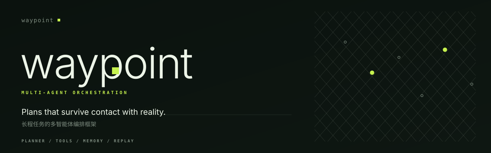

<p align="center">
  <picture>
    <source media="(prefers-color-scheme: dark)" srcset="assets/hero-dark.svg">
    <source media="(prefers-color-scheme: light)" srcset="assets/hero-light.svg">
    
  </picture>
</p>

<p align="center">
  <a href="https://www.python.org/"></a>
  
  
  
</p>

**A plan you can read. A run you can replay. A failure you can explain.**

Waypoint runs multi-step agent work as an explicit directed graph. Nothing hides
in a callback stack: the plan is data, every step names a tool, every dependency
is declared, and every run leaves a trace you can diff.

## A plan is a file

```json
{
  "goal": "research hybrid retrieval",
  "steps": [
    { "id": "collect",  "action": "gather_sources",
      "inputs": { "topic": "$goal.topic" } },
    { "id": "extract",  "action": "extract_facts",
      "inputs": { "source": "$collect.primary" }, "depends_on": ["collect"] },
    { "id": "write",    "action": "compose_report",
      "inputs": { "topic": "$goal.topic", "facts": "$extract.facts" },
      "depends_on": ["extract"], "retries": 1 }
  ]
}
```

`$step.field` is resolved by the executor; a dangling reference is rejected at
validation time, not at 2am in production.

## Watching a run happen

```console
$ python -m waypoint run --file examples/plan.json
ok · 6 steps · 0 failures
collect           ok     1 attempt    0.4 ms
extract_primary   ok     1 attempt    0.3 ms
extract_secondary ok     1 attempt    0.3 ms
merge             ok     1 attempt    0.2 ms
verify            ok     1 attempt    0.2 ms
write             ok     1 attempt    0.3 ms
```

The same result is available as JSON (`--json`), including a trace with
`run_start`, `step_ok`, `step_retry`, `step_skipped`, `run_end` events.

## When a step fails

Failure has three outcomes, and none of them is a stack trace:

| Situation | Step status | Dependents | Run status |
| --- | --- | --- | --- |
| Tool raises, retries remain | retried | untouched | — |
| Tool raises, retries exhausted | `failed` | `skipped` | `skipped` |
| Step budget exceeded | raises `BudgetExceeded` | — | aborts |

A `skipped` dependent records `dependency failed: <ids>`, so the reason survives
in the run file.

## Install and run

```bash
python -m pip install -e .
python -m waypoint plan "research hybrid retrieval"   # print a plan
python -m waypoint validate examples/plan.json        # structural checks
python -m waypoint run --goal "research hybrid retrieval"
```

## Inside the box

| Path | Responsibility |
| --- | --- |
| `plan/model.py` | `Step`, `Status`, `StepResult`, `RunResult`, error types |
| `plan/planner.py` | `Plan`, DAG validation, deterministic ordering, templates |
| `protocols.py` | `Planner`, `Tool`, `Observer` — the runtime only sees these |
| `runtime/executor.py` | Dependency-ordered execution, input resolution, retries |
| `runtime/policies.py` | `RetryPolicy`, `BudgetPolicy`, checkpoint save/restore |
| `runtime/trace.py` | Structured event log |
| `toolkit/registry.py` | Typed tool registry with argument schema checks |
| `toolkit/builtins.py` | The offline tool set used by the examples |
| `schemas/plan.schema.json` | JSON Schema for a plan document |
| `recipes/` | Ready-to-run plan files (research, fix) |

## Numbers

Six-step research plan, `python benchmarks/bench.py`, Apple arm64, CPython 3.14.6,
single process. Indicative for this machine only.

| Metric | Value |
| --- | ---: |
| Validation throughput | 214,659 plans/s |
| Run throughput | 66,526 plans/s |
| Run p50 | 0.02 ms |
| Run p95 | 0.03 ms |

## Limits

Waypoint is an execution kernel. It does not call a model, does not schedule
across processes, and its planner is rule-based on purpose. Independent branches
run sequentially today; parallelism is the next honest step, not a current
feature.
